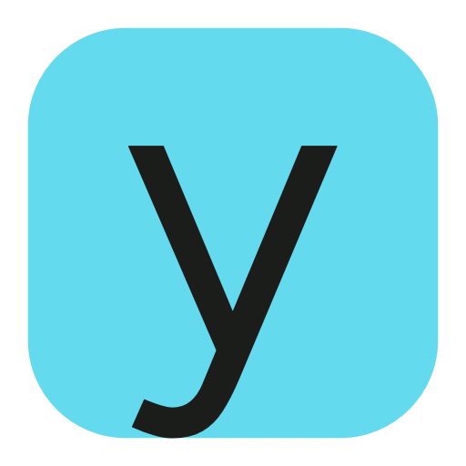
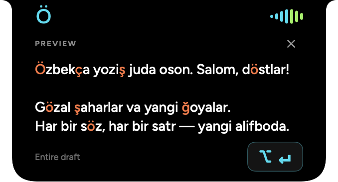

<div align="center">



# Yoz

### Your words. A new alphabet.

Write Uzbek in the apps you already use.<br>
Review the new letters in your Mac’s notch. Keep writing with one shortcut.

[](packaging/Info.plist)
[](#install)
[](#install)
[](#your-data)

**[Install](#install) · [Shortcuts](#shortcuts) · [The alphabet](#the-alphabet) · [Your data](#your-data) · [Development](#development)**



</div>

## Write once. Review the whole draft.

Uzbek text often mixes apostrophe styles and multi-letter spellings. Yoz brings
those letters into the new alphabet without making you move your draft into
another app.

Enable it when you write Uzbek. Type as usual, pause, and review the **entire
editable field**—sentences, paragraphs, blank lines, and text after the cursor.
Accept once to replace the whole draft.

```text
O'zbekcha yozish juda oson.

Go'zal shaharlar va yangi g'oyalar.
                         ↓
Özbekça yoziş juda oson.

Gözal şaharlar va yangi ğoyalar.
```

| Feature | What you get |
| --- | --- |
| **Whole-draft conversion** | One suggestion for all paragraphs in the focused editor, up to 200,000 UTF-16 units. Selecting a paragraph does not narrow the scope. |
| **Changes you can see** | Converted letters appear inline in cosmic orange; surrounding text stays readable. |
| **A notch that stays put** | Ö and the waveform keep their screen positions while the result expands. The body aligns with their outer edges. |
| **A deliberate toggle** | Double-press Right Shift or double-click ö in the menu bar to enable or pause suggestions. |
| **A local Playground** | Convert and copy text without granting Accessibility access. |
| **App-level control** | Exclude apps, check detection status, or opt into automatic replacement after a pause. |

## From typing to result

<div align="center">

</div>

1. **Type.** Ö stays fixed; the right-hand waveform shows that Yoz is following your input.
2. **Pause.** After 650 ms, the notch expands smoothly and reveals the converted draft.
3. **Review and accept.** Click **⌥ ↵** or press **Option + Return**. Press **Escape** to dismiss.

The result grows just **22 points wider** than the compact notch. Its text keeps
a fixed layout during the transition, and long drafts scroll inside the panel.
On a display without a camera notch, Yoz sits at the top center of the screen.

Accepting a suggestion keeps the original editor active. If its text, selection,
or focus changes before acceptance, Yoz waits for a fresh suggestion.

## Install

**Requirements:** macOS 13 or later. Current packaged builds target Apple silicon.
Building from source needs Xcode Command Line Tools with Swift 5.9 or later.

### Build the app

```bash
git clone https://github.com/abduraufdev77/yoz.git
cd yoz
./scripts/build.sh
```

The app is created at `dist/Yoz.app`.

1. Drag **Yoz.app** into **Applications** and open it.
2. Choose **Enable Accessibility** in Yoz.
3. In **System Settings → Privacy & Security → Accessibility**, allow Yoz.
4. Double-press **Right Shift** to enable suggestions, then type in a supported editor.

New installations start **paused**, with automatic replacement **off**. Updates
preserve your preferences. Closing the main window keeps Yoz available in the
menu bar.

Current builds are signed ad hoc for local development and are not notarized.
Public binary distribution requires Developer ID signing and Apple notarization.

### Package an installer

```bash
./scripts/package-dmg.sh
```

This creates `dist/Yoz-0.4.2-arm64.dmg` and `dist/SHA256SUMS.txt`. The script reads
the version from `packaging/Info.plist`.

To update, quit Yoz, replace the installed app, and reopen it. A rebuilt or moved
app may need its Accessibility grant renewed.

## Shortcuts

| Action | Shortcut or gesture |
| --- | --- |
| Enable or pause Yoz | Double-press **Right Shift** |
| Enable or pause from the menu bar | Double-click **ö** |
| Accept the complete suggestion | **Option + Return**, or click **⌥ ↵** |
| Dismiss the suggestion | **Escape** |
| Open Yoz, preview the notch, or quit | Click **ö** to open its menu |
| Open the notch’s menu | Right-click the notch |

Normal Shift typing is preserved. Other keys or modifier combinations interrupt
the double-press gesture, so using Right Shift in a typing shortcut does not count
as a double-press toggle.

## The alphabet

Yoz performs a mechanical conversion of Uzbek Latin text using the project’s
alphabet reference.

| Existing form | New form | Example |
| --- | --- | --- |
| `O‘` / `o‘` | `Ö` / `ö` | `o'zbek` → `özbek` |
| `G‘` / `g‘` | `Ğ` / `ğ` | `g'oya` → `ğoya` |
| `Sh` / `sh` | `Ş` / `ş` | `shahar` → `şahar` |
| `Ch` / `ch` | `Ç` / `ç` | `chiroq` → `çiroq` |

- **Case stays intact:** `SHOSHILINCH` becomes `ŞOŞILINÇ`.
- **Apostrophe variants are accepted:** straight, curly, modifier, backtick, and related marks after `o` and `g`.
- **Tutuq is retained:** `ma'no` becomes `ma’no`; `ng` stays as two letters.
- **Addresses are protected:** URLs, email addresses, and domain names keep their original spelling.
- **Paragraph structure is preserved:** blank lines and text after the cursor remain part of the draft.

Yoz currently accepts **Uzbek Latin**. It does not translate, correct spelling,
infer the language, or convert Cyrillic. An English word containing `sh` or `ch`
can also change—enable Yoz when you want the Uzbek conversion.

## Settings

| Control | Default | Behavior |
| --- | --- | --- |
| Suggest while I type | Off on a new installation | Enables draft detection and the notch. Updates keep your existing preference. |
| Apply automatically after a pause | Off | Replaces the entire editable field after the pause, without manual acceptance. |
| App exclusions | No custom exclusions | Stops suggestions in the apps you choose. Built-in protected-app exclusions still apply. |
| Live detection | Status display | Explains whether Yoz is waiting, paused, ready, or unable to read the editor. |
| Accessibility | macOS permission | Required for cross-app detection, replacement, and global shortcuts. |

Preferences are stored locally with macOS UserDefaults. The Playground works
without Accessibility permission.

## Your data

**Yoz’s conversion engine runs on your Mac.** The app has no network client,
account, analytics, or typed-text history.

- It reads the **focused editable field** through macOS Accessibility, rather than collecting characters from keyboard events.
- Password fields, protected content, Terminal, and common password managers are skipped. macOS Secure Input pauses detection and replacement.
- Before replacing text, it rechecks the foreground app, editor identity, draft, and selection. The complete result is read back before success is counted.
- Diagnostic output contains detection statuses and app names, **never the draft text**.

Direct replacement uses Accessibility. Some web editors ignore that API; Yoz
then uses one standard paste in the verified editor. It preserves the previous
clipboard items and restores them afterward unless something newer was copied.
The Playground’s **Copy** action intentionally updates the clipboard.

### Background work

Accessibility notifications and coalesced input events drive detection. A
**two-second recovery check** covers editors that do not send notifications;
unchanged drafts skip repeat conversion. Scheduled checks stop while Yoz is
paused or the Mac is asleep.

Only the right-hand waveform animates. It stops when idle, briefly settles after
a result arrives, and pauses in **Low Power Mode** or with **Reduce Motion**.

## Compatibility and troubleshooting

Yoz works with editable fields that expose usable macOS Accessibility text and
selection APIs. Support in Telegram, email clients, and websites depends on the
editor implementation. Local AppKit and WebKit fixtures are used for live checks;
the [validation notes](docs/live-test-results.md) distinguish verified behavior
from checks that still need manual acceptance.

<details>
<summary><strong>No suggestion appears</strong></summary>

- Check that Yoz is enabled; double-press Right Shift or inspect the ö menu.
- Confirm Accessibility access for the app you are actually running.
- Type in an editable field and pause for at least 650 ms.
- Open **Settings → Live detection** to see why the field was skipped.
- Check app exclusions and any active password prompt or Secure Input state.
- If the editor does not expose its text, use the Playground.

</details>

<details>
<summary><strong>The preview disappeared before I accepted it</strong></summary>

Typing, moving the selection, or switching editors invalidates the previous
preview. Pause in the intended field to get a fresh one. Fields larger than
200,000 UTF-16 units are skipped rather than silently truncated.

</details>

<details>
<summary><strong>Can I convert only a selection, or use Cyrillic?</strong></summary>

Cross-app suggestions cover the **whole focused editable field**, including text
after the cursor. A selection does not restrict that scope. Copy a smaller
passage into the Playground when you want to convert it separately. Cyrillic
conversion is not part of this release.

</details>

## Development

Yoz uses **SwiftUI + AppKit**, with no external Swift package dependencies.

```bash
swift test                  # Run the automated suite
./scripts/build.sh          # Build and sign dist/Yoz.app
./scripts/package-dmg.sh    # Create a versioned DMG and checksum
```

The **27 automated tests** cover alphabet rules, case, protected addresses,
Unicode offsets, whole-field scope, nested editors, paragraph boundaries,
double-press timing, and notch geometry across displays and backing scales.

<details>
<summary><strong>Project structure</strong></summary>

```text
Sources/
  TransliterationCore/       Conversion, editor scope, input timing, notch geometry
  Yoz/                       Native app, Accessibility monitor, notch, settings
Tests/
  TransliterationCoreTests/   Conversion and interaction regression tests
scripts/                     Build, package, icons, and a local editor fixture
packaging/                   App metadata and icons
docs/                        Screenshots, capture geometry, and validation notes
```

The monitor resolves the containing editable root so a focused paragraph does
not become a partial-draft suggestion. SwiftUI draws the notch inside a
non-activating AppKit panel; the persistent band is separate from the resizing
silhouette. The canvas stays large enough for the spring and shrinks only after
the transition finishes.

</details>

<details>
<summary><strong>Visual checks and diagnostics</strong></summary>

Quit any running copy before launching a development capture.

```bash
mkdir -p tmp/notch-preview
dist/Yoz.app/Contents/MacOS/Yoz --background \
  --notch-gallery "$PWD/tmp/notch-preview"
```

| Flag | Output |
| --- | --- |
| `--notch-gallery <folder>` | Processing, result, idle, and transition PNGs with native geometry JSON. The folder must exist. |
| `--notch-snapshot <file.png>` | A notch preview capture. |
| `--capture-gallery <folder>` | Main app sections as PNGs; exits after capture. The folder must exist. |
| `--diagnostics` | Detection statuses and app names on standard output. |
| `--background` | Starts without opening the main window. |

The unsaved editor fixture in `scripts/LiveTestEditor.swift` supports native
AppKit and WebKit rich-text checks without opening a real conversation. Its test
text is synthetic.

</details>

## Contributing

[Report a bug](https://github.com/abduraufdev77/yoz/issues) with the Yoz version,
macOS version, editor name, and a synthetic example that reproduces the issue.
Do not include private messages, passwords, or personal documents.

For code changes, run `swift test` and verify changes to cross-app behavior in a
local disposable editor. Keep fixtures synthetic and third-party notices intact.

## Notices

Yoz is an independent app and is not affiliated with VoiceLab. Figtree and
Noto Sans include their SIL Open Font Licenses. Bundled third-party notices are
in [Sources/Yoz/Resources](Sources/Yoz/Resources).

<div align="center">

**Ö · Made for Uzbek writing on Mac.**

</div>
