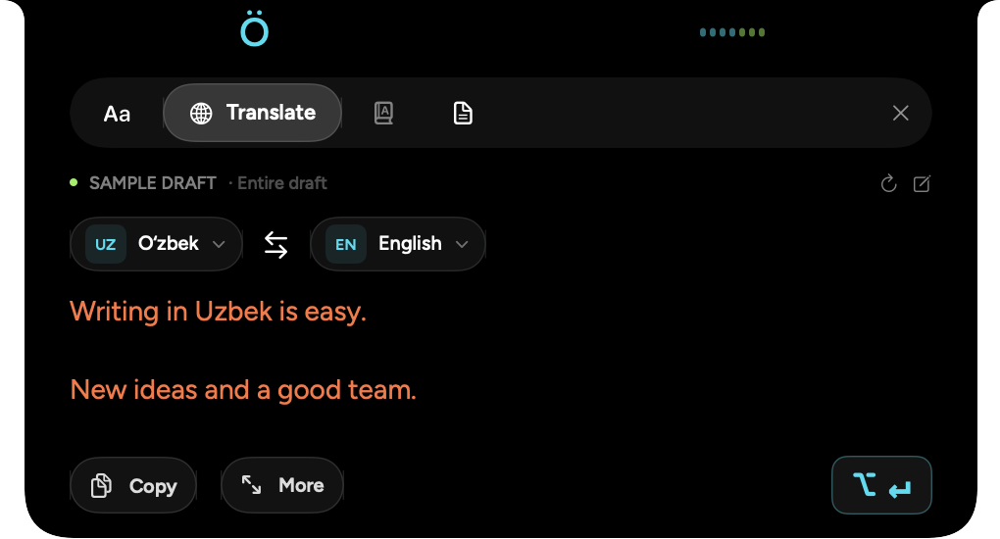
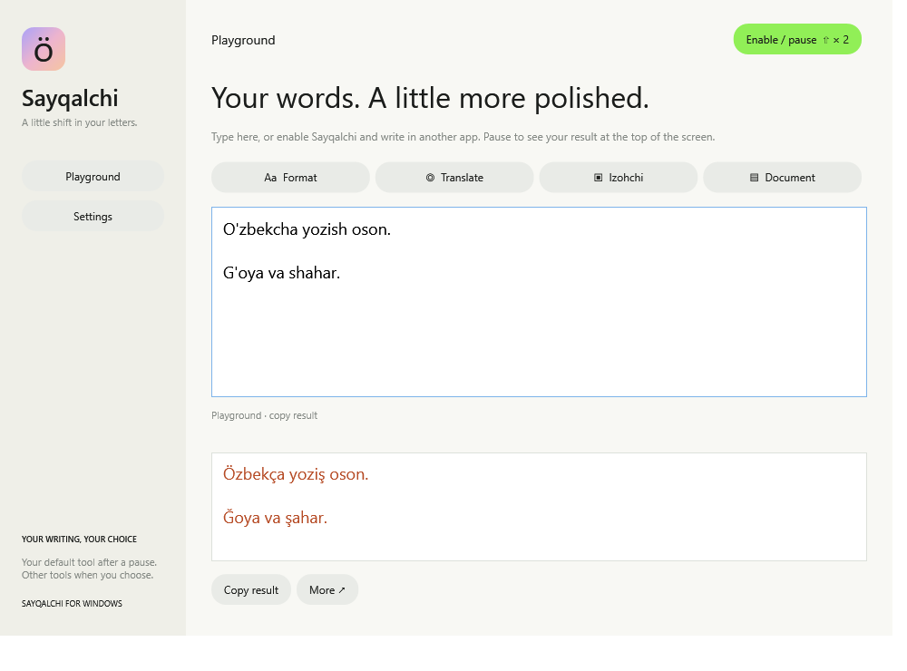
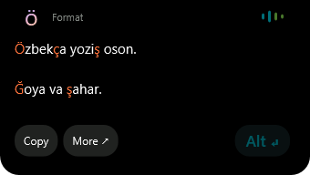

<div align="center">


# Sayqalchi

### Your everyday writing companion.

Previously **Yoz**. The new name keeps the same settings, Keychain service, and macOS bundle identity. Earlier Yoz release links still redirect to this repository.

Format. Translate. Understand. Keep writing.<br>
A native assistant in your Mac’s notch or at the top of your Windows screen.

[](packaging/Info.plist)
[](#install)
[](#install)
[](https://github.com/abduraufdev77/Sayqalchi/actions/workflows/windows.yml)
[](#your-data)

<a href="https://github.com/abduraufdev77/Sayqalchi/releases/download/v0.6.0-preview.1/Sayqalchi-0.6.0-arm64.dmg"></a>
<a href="https://github.com/abduraufdev77/Sayqalchi/releases/download/v0.6.0-preview.1/Sayqalchi-0.6.0-windows-x64.exe"></a>

**[Install](#install) · [Shortcuts](#shortcuts) · [The alphabet](#the-alphabet) · [Your data](#your-data) · [Development](#development)**


</div>

> **[Sayqalchi 0.6.0 preview](https://github.com/abduraufdev77/Sayqalchi/releases/tag/v0.6.0-preview.1):** macOS DMG + Windows EXE / portable ZIP. Windows is a new preview with editor compatibility limits. [Android options](docs/ANDROID.md) are assessed; no APK is shipped. The earlier stable formatter remains [Yoz 0.4.2](https://github.com/abduraufdev77/Sayqalchi/releases/tag/v0.4.2).

## One notch. Four writing tools.

<div align="center">

</div>

After a typing pause, Sayqalchi opens a compact result automatically, sized to its text. Hover over Ö to reveal the full tool strip; More opens the larger detail view. The logo and waveform keep their
positions while the black island expands below the camera. Only your default service runs after a typing pause. Its tab is electric green;
open another tab to run that service on demand. Review the result and copy it or replace the captured draft with **⌥ ↵**. Automatic results stay open until you accept, dismiss, or resume typing; hovering is optional.

| Tool | What it does | Processing |
| --- | --- | --- |
| **Format** | Convert the complete draft to the new Uzbek alphabet, with orange inline changes. | Local |
| **Translate** | Uzbek ↔ English, Uzbek ↔ Russian, Uzbek Latin ↔ Cyrillic. Use the public MyMemory provider without an account, or connect your own translation service. | Default service or on demand |
| **Izohchi** | Look up a selected word or short phrase. Two meanings and one example per meaning in the preview; **More** opens all meanings in a larger notch. | Izoh.uz, when selected |
| **Document** | Count words, characters and text lines, estimate reading time, and preview spacing cleanup while keeping paragraph breaks and indentation. | Local |

Use the pencil to enter or paste text directly. Manual input results can be copied;
replacing another app’s draft requires a fresh captured editor. **Refresh** reads
that editor again. Choose **Settings → Default service** in the main app. Format is the initial default and makes no network requests. Other services run only when their tab is open; switching away cancels unfinished work. Completed results are cached for the unchanged draft. Translation sends the draft to the provider selected in Settings; Izohchi sends the selection or word at the cursor. Pause Sayqalchi to stop processing.

### Translation without setup

New installations use **MyMemory · free** in **Settings → Translation service**.
No URL, login or API key is needed. The public API supports Uzbek ↔ English and
Uzbek ↔ Russian. Uzbek Latin ↔ Cyrillic runs locally without using a network quota.
Existing configured installations retain their custom service until changed.

MyMemory permits anonymous use up to **5,000 characters per day**, subject to
[provider limits](https://mymemory.translated.net/doc/usagelimits.php). Sayqalchi splits
long paragraphs into UTF-8-safe requests of at most 500 bytes and preserves all
paragraph separators. Drafts above 5,000 characters are rejected without truncation;
quota failures never become partial, usable results. It sends no API key, email,
Google credentials, or private-service headers to MyMemory. Its
[privacy policy](https://mymemory.translated.net/terms-and-conditions) permits
long-term retention of submitted text and processing by external translation
partners. Choose your own provider for private documents.

Google's supported inline API requires a [billing-enabled Cloud project](https://docs.cloud.google.com/translate/docs/setup)
and [API credentials](https://docs.cloud.google.com/translate/docs/authentication).
A normal Google login alone does not provide a free app-wide API. Sayqalchi does not
scrape Google Translate or ship a shared Google key.

### Connect your own translation service

Select **Custom service** in **Settings → Translation service**, then enter the
base URL and API key, or import a local `.env` using [`.env.example`](.env.example).
Your key is stored in macOS Keychain. Fresh URL/key defaults are empty, and no
credentials are shipped in the app.

The compact widget shows prepared results with small language badges and no processing buttons or promotional headings.

The custom service client uses `POST /api/translate/text`, `X-API-Token`, JSON fields
`sourceLanguage`, `targetLanguage`, `text`, and an NDJSON stream of `delta` events
ending in `done`. Choose source and target using the language badges; each badge opens a small language popover, and the middle arrow swaps the pair. Drafts over 20,000 Unicode scalars are rejected without truncation.
Partial output cannot be copied or applied. Cancel, changing direction, and editing
the input invalidate the pending request.

HTTPS is required by default. A separate opt-in permits unencrypted HTTP for a
user-configured development service; it exposes both the API key and submitted
text to the network. There is no automatic HTTPS downgrade or certificate bypass.

Izohchi fetches public definitions from **[Izoh.uz](https://izoh.uz/)** without an
account, keeps at most 40 lookups in memory for ten minutes, and links to the source.
**[Savodxon](https://savodxon.uz/izoh)** is available as a browser link; it currently
blocks automated requests, so the app does not claim to integrate its private API.
Missing definitions and unsupported phrases produce a clear no-result message.

## Write once. Review the whole draft.

Uzbek text often mixes apostrophe styles and multi-letter spellings. Sayqalchi brings
those letters into the new alphabet without making you move your draft into
another app.

Enable it when you write Uzbek. Type as usual, pause, and review the **entire
editable field**—sentences, paragraphs, blank lines, and text after the cursor.
Accept once to replace the whole draft.

```text
O'zbekcha yozish juda oson.

Go'zal shaharlar va yangi g'oyalar.
                         ↓
Özbekça yoziş juda oson.

Gözal şaharlar va yangi ğoyalar.
```

| Feature | What you get |
| --- | --- |
| **Whole-draft conversion** | One suggestion for all paragraphs in the focused editor, up to 200,000 UTF-16 units. Selecting a paragraph does not narrow the scope. |
| **Changes you can see** | Converted letters appear inline in cosmic orange; surrounding text stays readable. |
| **A notch that stays put** | Ö and the waveform keep their screen positions while the result expands. The body aligns with their outer edges. |
| **A deliberate toggle** | Double-press Right Shift or double-click ö in the menu bar to enable or pause suggestions. |
| **A local Playground** | Convert and copy text without granting Accessibility access. |
| **App-level control** | Exclude apps, check detection status, or opt into automatic replacement after a pause. |

## From typing to result

<div align="center">

</div>

1. **Type.** Ö stays fixed; the right-hand waveform shows that Sayqalchi is following your input.
2. **Pause.** After 650 ms, the notch expands smoothly and reveals the converted draft.
3. **Review and accept.** Click **⌥ ↵** or press **Option + Return**. Press **Escape** to dismiss.

The result grows just **22 points wider** than the compact notch. Its text keeps
a fixed layout during the transition, and long drafts scroll inside the panel.
On a display without a camera notch, Sayqalchi sits at the top center of the screen.

Accepting a suggestion keeps the original editor active. If its text, selection,
or focus changes before acceptance, Sayqalchi waits for a fresh suggestion.

## Install

| Platform | Download | Requirements |
| --- | --- | --- |
| macOS | **[Download DMG](https://github.com/abduraufdev77/Sayqalchi/releases/download/v0.6.0-preview.1/Sayqalchi-0.6.0-arm64.dmg)** | macOS 13+, Apple silicon |
| Windows | **[Download EXE installer](https://github.com/abduraufdev77/Sayqalchi/releases/download/v0.6.0-preview.1/Sayqalchi-0.6.0-windows-x64.exe)** · [Portable ZIP](https://github.com/abduraufdev77/Sayqalchi/releases/download/v0.6.0-preview.1/Sayqalchi-0.6.0-windows-x64.zip) | Windows 10 1809+ / Windows 11, x64; no .NET install needed |
| Android | [Options and proposed implementation](docs/ANDROID.md) | Assessment only; no APK yet |

[All downloads and SHA-256 checksums](https://github.com/abduraufdev77/Sayqalchi/releases/tag/v0.6.0-preview.1). The Windows EXE is an unsigned preview; the macOS DMG is development-signed and not notarized.

<details>
<summary><strong>See the Windows preview</strong></summary>




</details>

On **Windows**, install the EXE or extract the ZIP, then double-press Right Shift to enable. Accept with **Alt + Enter**. The tray menu opens Settings and the Playground. Only editors exposing writable Windows UI Automation fields support direct replacement; use copy in other editors. [Windows guide](docs/WINDOWS.md).

On **macOS**, drag the app to Applications, grant Accessibility and double-press Right Shift. Accept with **Option + Return**. Continue below for source builds and approval recovery.

### Build the preview app

```bash
git clone https://github.com/abduraufdev77/Sayqalchi.git
cd Sayqalchi
./scripts/build.sh
```

Run `./scripts/install-local.sh` to install the signed preview at `/Applications/Sayqalchi.app`. Always launch that copy; `dist/Sayqalchi.app` is the build output.

1. Drag **Sayqalchi.app** into **Applications** and open it.
2. Choose **Open Accessibility** in Sayqalchi.
3. In **System Settings → Privacy & Security → Accessibility**, allow Sayqalchi.
4. Double-press **Right Shift** to enable suggestions, then type in a supported editor.

New installations start **paused**, with automatic replacement **off**. Updates
preserve your preferences. Closing the main window keeps Sayqalchi available in the
menu bar.

The published 0.4.2 build is signed ad hoc and is not notarized. New local builds require an installed Apple signing certificate so Accessibility approval can survive rebuilding. Disposable development builds can explicitly opt into ad-hoc signing with `YOZ_ALLOW_ADHOC_SIGNING=1`; these require renewed permission after every rebuild.
macOS may require **System Settings → Privacy & Security → Open Anyway**. Developer ID signing and notarization remain future distribution work.

### Package an installer

```bash
./scripts/package-dmg.sh
```

This creates `dist/Sayqalchi-0.6.0-arm64.dmg` and `dist/SHA256SUMS.txt`. The script reads
the version from `packaging/Info.plist`.

To update, quit Sayqalchi, replace the installed app, and reopen it. A rebuilt or moved
app may need its Accessibility grant renewed once when moving from ad-hoc signing to a certificate. If the old **Yoz** switch is on but Sayqalchi reports permission missing, remove that entry with **−**, then add `/Applications/Sayqalchi.app` with **+** and enable it. macOS may still be approving the old binary hash. Sayqalchi checks permission without repeatedly opening authorization dialogs, and reconnects the shortcut after approval even while paused.

## Shortcuts

| Action | Shortcut or gesture |
| --- | --- |
| Enable or pause Sayqalchi | Double-press **Right Shift** |
| Enable or pause from the menu bar | Double-click **ö** |
| Accept the complete suggestion | macOS: **Option + Return** · Windows: **Alt + Enter**, or click the combined button |
| Dismiss the suggestion or assistant | **Escape** |
| Open writing tools | Hover the notch, or choose **Writing tools** in the ö menu |
| Open Sayqalchi, preview the notch, or quit | Click **ö** to open its menu |
| Open the notch’s menu | Right-click the notch |

Normal Shift typing is preserved. Other keys or modifier combinations interrupt
the double-press gesture, so using Right Shift in a typing shortcut does not count
as a double-press toggle.

## The alphabet

Sayqalchi performs a mechanical conversion of Uzbek Latin text using the project’s
alphabet reference.

| Existing form | New form | Example |
| --- | --- | --- |
| `O‘` / `o‘` | `Ö` / `ö` | `o'zbek` → `özbek` |
| `G‘` / `g‘` | `Ğ` / `ğ` | `g'oya` → `ğoya` |
| `Sh` / `sh` | `Ş` / `ş` | `shahar` → `şahar` |
| `Ch` / `ch` | `Ç` / `ç` | `chiroq` → `çiroq` |

- **Case stays intact:** `SHOSHILINCH` becomes `ŞOŞILINÇ`.
- **Apostrophe variants are accepted:** straight, curly, modifier, backtick, and related marks after `o` and `g`.
- **Tutuq is retained:** `ma'no` becomes `ma’no`; `ng` stays as two letters.
- **Addresses are protected:** URLs, email addresses, and domain names keep their original spelling.
- **Paragraph structure is preserved:** blank lines and text after the cursor remain part of the draft.

The Format tool accepts **Uzbek Latin**. It does not translate, correct spelling,
infer the language, or convert Cyrillic. An English word containing `sh` or `ch`
can also change—enable Sayqalchi when you want the Uzbek conversion.

## Settings

| Control | Default | Behavior |
| --- | --- | --- |
| Suggest while I type | Off on a new installation | Enables draft detection and the notch. Updates keep your existing preference. |
| Default service | Format | Runs after a pause; other tools run when opened. |
| Apply automatically after a pause | Off | Replaces the entire editable field after the pause, without manual acceptance. |
| App exclusions | No custom exclusions | Stops suggestions in the apps you choose. Built-in protected-app exclusions still apply. |
| Live detection | Status display | Explains whether Sayqalchi is waiting, paused, ready, or unable to read the editor. |
| Accessibility | macOS permission | Required for cross-app detection, replacement, and global shortcuts. |

Preferences are stored locally with macOS UserDefaults. The Playground works
without Accessibility permission.

## Your data

**Formatting and document tools run on your Mac.** Sayqalchi has no analytics or
persistent typed-text history. It keeps the captured draft and result in memory
while the assistant is open and clears them when you close it.

- **Translation:** after a typing pause, Sayqalchi sends the complete focused draft or manually entered text to the selected public or custom provider. MyMemory may retain submitted segments long term; the custom provider’s own retention policy applies.
- **Izohchi:** each pause sends only the selected word/phrase or word at the cursor to Izoh.uz. A bounded temporary memory cache avoids repeat requests.
- API keys live in Keychain; the URL and HTTP preference live in UserDefaults. `.env` files are ignored by Git and never bundled. Public translation has no credentials to store.
- Network requests use an ephemeral session without persistent cookies or a disk cache. Credentials are not forwarded across origins during redirects.

- It reads the **focused editable field** through macOS Accessibility, rather than collecting characters from keyboard events.
- Password fields, protected content, Terminal, and common password managers are skipped. macOS Secure Input pauses detection and replacement.
- Before replacing text, it rechecks the foreground app, editor identity, draft, and selection. The complete result is read back before success is counted.
- Diagnostic output contains detection statuses and app names, **never the draft text**.

Direct replacement uses Accessibility. Some web editors ignore that API; Sayqalchi
then uses one standard paste in the verified editor. It preserves the previous
clipboard items and restores them afterward unless something newer was copied.
Explicit **Copy** actions intentionally update the clipboard. Captured assistant results are revalidated against the complete original draft before replacement.

### Background work

Accessibility notifications and coalesced input events drive detection. A
**two-second recovery check** covers editors that do not send notifications;
unchanged drafts skip repeat conversion. Scheduled checks stop while Sayqalchi is
paused or the Mac is asleep.

Only the right-hand waveform animates. It stops when idle, briefly settles after
a result arrives, and pauses in **Low Power Mode** or with **Reduce Motion**.

## Compatibility and troubleshooting

Sayqalchi works with editable fields that expose usable macOS Accessibility text and
selection APIs. Support in Telegram, email clients, and websites depends on the
editor implementation. Local AppKit and WebKit fixtures are used for live checks;
the [validation notes](docs/live-test-results.md) distinguish verified behavior
from checks that still need manual acceptance.

<details>
<summary><strong>No suggestion appears</strong></summary>

- Check that Sayqalchi is enabled; double-press Right Shift or inspect the ö menu.
- Confirm Accessibility access for the app you are actually running.
- Type in an editable field and pause for at least 650 ms.
- Open **Settings → Live detection** to see why the field was skipped.
- Check app exclusions and any active password prompt or Secure Input state.
- If the editor does not expose its text, use the Playground.

</details>

<details>
<summary><strong>The preview disappeared before I accepted it</strong></summary>

Typing, moving the selection, or switching editors invalidates the previous
preview. Pause in the intended field to get a fresh one. Fields larger than
200,000 UTF-16 units are skipped rather than silently truncated.

</details>

<details>
<summary><strong>Can I convert only a selection, or use Cyrillic?</strong></summary>

Cross-app suggestions cover the **whole focused editable field**, including text
after the cursor. A selection does not restrict that scope. Copy a smaller
passage into the Playground when you want to convert it separately. Cyrillic
conversion is local with the public provider in the current preview; it is not included in the older stable 0.4.2 formatter.

</details>

## Development

Sayqalchi uses **SwiftUI + AppKit**. The internal SwiftPM target and resource filenames retain Yoz for compatibility; the installed executable, product and installer are named Sayqalchi. **SwiftSoup** parses dictionary HTML without executing scripts; its MIT notice is bundled with the app. `Package.resolved` pins the dependency.

```bash
swift test                  # Run the automated suite
./scripts/build.sh          # Build and sign dist/Sayqalchi.app
./scripts/package-dmg.sh    # Create a versioned DMG and checksum
```

The **64 macOS automated tests** cover alphabet rules, Unicode offsets, whole-field
scope, nested editors, paragraph boundaries, double-press timing, notch geometry,
the six translation directions and HTTP contract, incomplete/error streams,
dictionary parsing and preview limits, URL validation, document cleanup, automatic preparation, cancellation, and cached tab switching.
Mock transport tests do not require credentials or internet access. The Windows engine/service suite adds **44 checks**, including the same shared alphabet fixtures. Windows CI also runs native UI Automation and installer smoke checks. See [Windows development](docs/WINDOWS.md) and [release packaging](docs/RELEASING.md).

See [0.5.0 validation notes](docs/assistant-validation.md) for live checks and known limits.

<details>
<summary><strong>Project structure</strong></summary>

```text
Sources/
  TransliterationCore/       Conversion, editor scope, input timing, notch geometry
  AssistantCore/             Translation transport, dictionary parser, document tools
  Yoz/                       Native app, Accessibility monitor, notch, settings
Tests/
  TransliterationCoreTests/   Conversion and interaction regression tests
  AssistantCoreTests/         Network contract, parser, and document tests
scripts/                     Build, package, icons, and a local editor fixture
packaging/                   App metadata and icons
docs/                        Screenshots, capture geometry, and validation notes
```

The monitor resolves the containing editable root so a focused paragraph does
not become a partial-draft suggestion. SwiftUI draws the notch inside a
non-activating AppKit panel; the persistent band is separate from the resizing
silhouette. The canvas stays large enough for the spring and shrinks only after
the transition finishes.

</details>

<details>
<summary><strong>Visual checks and diagnostics</strong></summary>

Quit any running copy before launching a development capture.

```bash
mkdir -p tmp/notch-preview
dist/Sayqalchi.app/Contents/MacOS/Sayqalchi --background \
  --notch-gallery "$PWD/tmp/notch-preview"
```

| Flag | Output |
| --- | --- |
| `--notch-gallery <folder>` | Processing, result, idle, and transition PNGs with native geometry JSON. The folder must exist. |
| `--notch-snapshot <file.png>` | A notch preview capture. |
| `--capture-gallery <folder>` | Main app sections as PNGs; exits after capture. The folder must exist. |
| `--diagnostics` | Detection statuses and app names on standard output. |
| `--background` | Starts without opening the main window. |

The unsaved editor fixture in `scripts/LiveTestEditor.swift` supports native
AppKit and WebKit rich-text checks without opening a real conversation. Its test
text is synthetic.

</details>

## Contributing

[Report a bug](https://github.com/abduraufdev77/yoz/issues) with the Sayqalchi version,
macOS version, editor name, and a synthetic example that reproduces the issue.
Do not include private messages, passwords, or personal documents.

For code changes, run `swift test` and verify changes to cross-app behavior in a
local disposable editor. Keep fixtures synthetic and third-party notices intact.

## Notices

Sayqalchi is an independent app and is not affiliated with VoiceLab. Figtree and
Noto Sans include their SIL Open Font Licenses. Bundled third-party notices are
in [Sources/Yoz/Resources](Sources/Yoz/Resources).

<div align="center">

**Ö · Made for Uzbek writing on Mac.**

</div>


## Credential audit

`scripts/audit-secrets.py` checks working source files and the built bundle for
known local secrets/private endpoint values and common credential signatures.
`--history` also scans every reachable Git blob. It reports paths, never matched
values. Build packaging runs the audit before signing. Real `.env` variants are
ignored; `.env.example` contains only a placeholder URL and an empty key.

```sh
python3 scripts/audit-secrets.py --history --bundle dist/Sayqalchi.app
```

This is a targeted audit, not a guarantee against every possible secret format.
