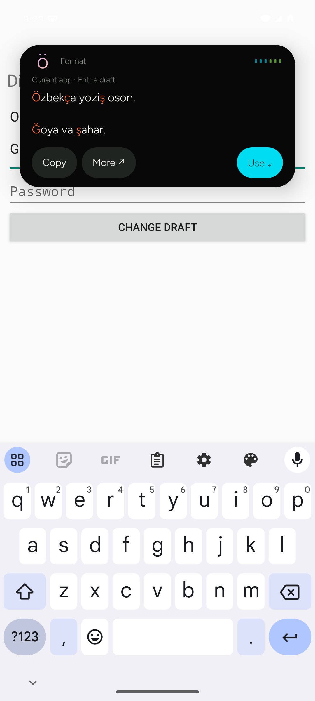

# Sayqalchi for Android — 0.6.1 preview

**[Download the signed Android APK](https://github.com/abduraufdev77/Sayqalchi/releases/download/v0.6.1-android.1/Sayqalchi-0.6.1-android.apk)** · [Release and SHA-256 checksum](https://github.com/abduraufdev77/Sayqalchi/releases/tag/v0.6.1-android.1)

Android 8.0 or later. One small universal APK, with no account, API key, Google
Play Services or replacement keyboard required for local formatting.
This is a sideloaded preview, not a Google Play release.



## Enable the popup

1. Install the APK, open **Sayqalchi**, and tap **Enable suggestions**.
2. Read the app's disclosure and choose **Continue**. In Android's Accessibility
   settings, open **Sayqalchi suggestions** and enable it yourself.
3. Return to your editor, type normally with your existing keyboard, and pause
   for about 650 ms. A compact black island animates while preparing the result,
   then expands automatically to show the converted text.
4. Tap **Use ↵** to replace the entire captured editable field, including all
   paragraphs. Copy is explicit; **More** opens the complete result.
5. Tap the popup header to reveal service tabs, translation language badges,
   Dismiss and Pause. Settings in the main app chooses the default service.

Android 13+ may restrict Accessibility for apps installed outside an app store.
If the switch is blocked, review the app and follow Android's own **App info →
Allow restricted settings** flow before enabling it. Sayqalchi never grants or
changes this permission itself. [Android's explanation](https://support.google.com/android/answer/12623953).

The popup sits near the top, below the status bar/camera safe area, and leaves
your keyboard in place. It hides for password fields, protected apps and the
lock screen. It also hides when the active field cannot be read safely.
The waveform runs only while processing and respects power saving / disabled
system animations. Expansion and collapse are animated.

## Four services

| Service | Behavior | Processing |
| --- | --- | --- |
| Format | o‘ → ö, g‘ → ğ, sh → ş, ch → ç; links, case and paragraphs preserved | On device |
| Translate | Uzbek ↔ English / Russian; Uzbek Latin ↔ Cyrillic | MyMemory or your custom service; script conversion stays local |
| Izohchi | Word at the cursor or explicit selected phrase; two meanings, one example each; More shows the rest | Izoh.uz |
| Document | Word/character/paragraph counts, reading time, whitespace cleanup | On device |

Only the configured default service runs after a pause. Opening another tab runs
that tool for the current draft. The active badge is electric green. Result
letters use cosmic orange. No marketing headings fill the popup result area.

The main app also includes a Playground, a Share receiver and Android's selected
text action. Select text → **Sayqalchi** to process a passage and return the result
when the host editor allows it. The Playground supports explicit copying when a
custom editor cannot provide writable accessibility text.

## Pause and settings

Pause from the popup or the main app. Add the **Sayqalchi** Quick Settings tile to
resume or pause without reopening the app. Android 13+ has an Add tile button in
Settings; older Android versions use the system's Quick Settings editor.

Settings includes the default service, language directions, custom translation
URL/key, explicit HTTP opt-in and comma-separated app-package exclusions.
Fresh installations start paused with local Format as the default.

## Privacy and editor limits

- Accessibility is used only after the in-app disclosure and your Android grant.
  The app reads the focused, editable field; it does not scan message histories.
- Password/PIN fields, known password managers, terminals, sensitive system
  screens and locked devices are skipped before reading text.
- Applying checks the same focused node, app package, window and full original
  text again. A changed draft is rejected. Only an explicit Use tap replaces it;
  it never sends a message or presses an editor's Send button.
- Format, Document and script conversion use no network. Translate sends the
  draft only when selected; Izohchi sends only a word or selected phrase.
- MyMemory works without a key and has a free 5,000-character/day quota. It may
  retain submitted text. [Provider terms](https://mymemory.translated.net/terms-and-conditions).
- Custom API keys use AES-GCM with an Android Keystore key. No key or private
  endpoint is compiled into the APK. App backup/transfer of settings and encrypted
  credentials is excluded; no typing history or analytics is saved.
- HTTPS is required unless you explicitly allow HTTP for your custom service.
  HTTP exposes text and credentials. Redirects do not receive the custom key.
- Unsupported or unusually long fields are skipped, not silently truncated.
  The field limit is 200,000 UTF-16 units; providers may impose smaller limits.
  Some custom editors, remote desktops and OEM Android builds limit accessible
  text or refuse `ACTION_SET_TEXT`. Use the Playground / selection action there.

## Build and sign

Requires Android SDK 36 and JDK 21 (Android Studio's bundled JBR works):

```bash
android/gradlew -p android :core:test :app:lintDebug :app:assembleDebug
python3 scripts/package-android.py
```

Packaging creates `dist/Sayqalchi-0.6.1-android.apk` and
`dist/SHA256SUMS-android.txt`. It runs core tests, release lint, APK signature
verification and the credential audit against the extracted APK.

The APK release signing profile is created once under
`~/.local/share/sayqalchi/android/`, outside the repository, with restricted file
permissions. Keep a secure backup: future Android updates must use the same key.
No keystore, signing password or signing profile belongs in Git or release assets.
To use an existing signing identity, supply all four environment variables:
`SAYQALCHI_ANDROID_KEYSTORE`, `SAYQALCHI_ANDROID_STORE_PASSWORD`,
`SAYQALCHI_ANDROID_KEY_ALIAS`, `SAYQALCHI_ANDROID_KEY_PASSWORD`.

## Validation

Nine JVM test groups cover shared desktop alphabet fixtures, complete-draft
scope, stale targets, protected links, local scripts, provider credential
isolation, paragraph-preserving segmentation, dictionary limits, URL checks,
completed streams and cancellation.

Eight Android 15 emulator integration tests exercise a separate disposable
editor app: popup after pause, whole-paragraph Use, stale result protection,
password exclusion, custom HTTP translation with a local test server, pausing,
local Cyrillic conversion/details, popup language selection and Keystore encryption. Instrumentation
permission setup is guarded to run only on disposable emulators; it is not part
of the release APK. The test editor and mock credentials are not shipped.

The Android GitHub workflow builds, lints and runs these checks on its own emulator.
Physical Telegram, Gmail and OEM-specific compatibility still needs device testing.

Platform references: [AccessibilityService](https://developer.android.com/reference/android/accessibilityservice/AccessibilityService),
[accessibility overlays](https://developer.android.com/reference/android/view/WindowManager.LayoutParams#TYPE_ACCESSIBILITY_OVERLAY),
[ACTION_SET_TEXT](https://developer.android.com/reference/android/view/accessibility/AccessibilityNodeInfo#ACTION_SET_TEXT),
[Android Keystore](https://developer.android.com/privacy-and-security/keystore).
